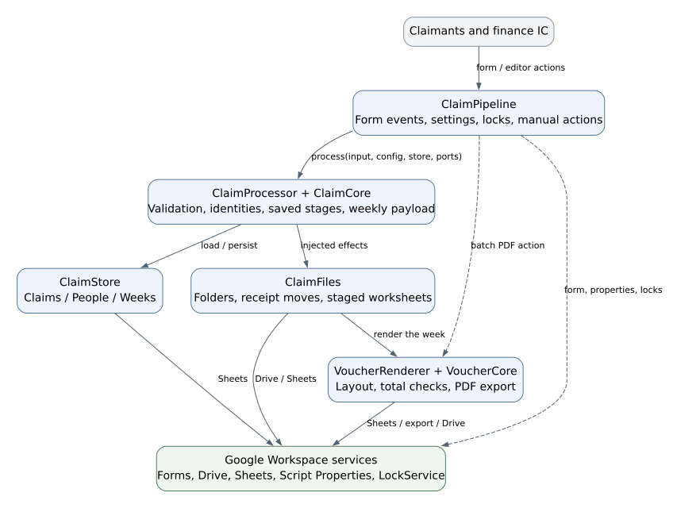
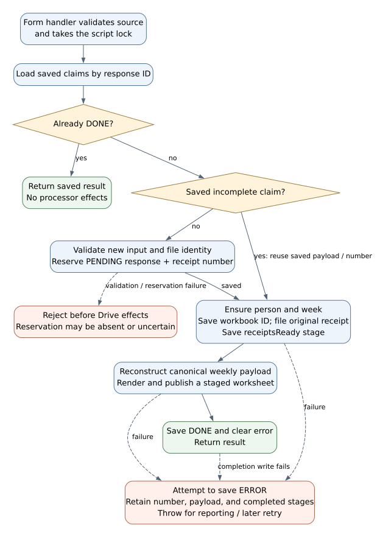
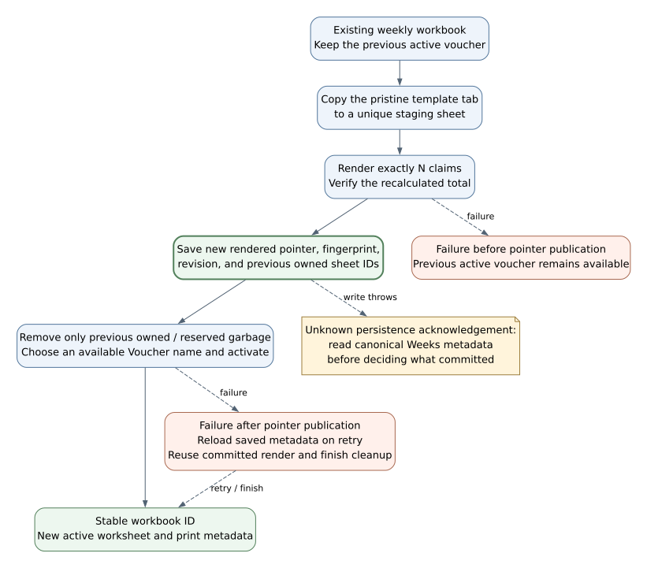

# KY Speedy Claims Developer Guide

KY Speedy Claims is a Google Apps Script application for an event finance IC. It turns Google Form submissions into numbered receipt files, a persistent claims register, one voucher workbook per claimant/week, and PDFs for the current week's claimants.

This guide describes the current source, including optional congregation collection, configurable event-folder placement, and weekly batch PDF export. Refer to the [User Guide](UserGuide.md) for operator instructions and the [decision log](decisions.md) for accepted requirements and unresolved production choices.

## Contents

- [Acknowledgements](#acknowledgements)
- [Setting up and getting started](#setting-up-and-getting-started)
- [Design](#design)
- [Implementation](#implementation)
- [Design considerations](#design-considerations)
- [Documentation logging testing and operations](#documentation-logging-testing-and-operations)
- [Appendix requirements](#appendix-requirements)
- [Appendix manual testing](#appendix-manual-testing)

## Acknowledgements

The organisation of this guide follows the [HiveMind Developer Guide](https://ay2627s1-cs2103t-t10-3.github.io/tp/DeveloperGuide.html): setup, component design, feature implementation, design choices, development practices, requirements, and manual-testing appendices. The components and diagrams here describe KY Speedy Claims.

The approved finance voucher supplies the document layout. Its labels, columns, totals, and signature areas remain the output contract. [Template findings](voucher-template.md) document the inspected layout and source-master restrictions.

Google's [upload-routing sample](https://developers.google.com/apps-script/samples/automations/upload-files), [PDF-generation sample](https://developers.google.com/apps-script/samples/automations/generate-pdfs), and platform references inform the integration. Node.js built-in modules provide the local test/build tooling. There are no npm runtime dependencies in this repository.

## Setting up and getting started

### Local environment

Use Node.js 20 or later; CI uses Node.js 22. From the repository root:

```sh
npm run check
npm test
npm run bundle -- --pipeline
```

No dependency installation is required for these commands. The pipeline bundle is written to ignored `local/form-test/` and contains `Code.gs`, `appsscript.json`, and `START-HERE.md`. To select an output directory:

```sh
npm run bundle -- /absolute/path/to/form-test --pipeline
```

Without `--pipeline`, the same program source is bundled with the older voucher-prototype guide under `local/live-test/`. The flag selects the guide/default directory, not a different runtime implementation.

The bundler concatenates modules in a fixed order, parses the combined script, copies the manifest, and embeds a SHA-256 fingerprint of the combined source and manifest. Preserve the fingerprint when recording a native test. It identifies bundle contents, not proof of a particular Google installation's state.

### Google environment

For a standalone installation, install the bundle under the event's operating account using the [pipeline setup and test sequence](form-pipeline-test.md): manifest, Advanced Drive service, Script Properties, setup, the manually added upload question, activation, and an actual browser submission. For the bound workbook, use the [maintainer installation instructions](setup-workbook.md#maintainer-prepare-the-blank-template-once). No web-app deployment is required. The [User Guide](UserGuide.md#set-up-an-event) covers the finance IC's workbook workflow.

The manifest specifies V8, `Asia/Singapore`, Advanced Drive v2 with identifier `Drive`, and these OAuth scopes:

| Scope suffix | Use |
| --- | --- |
| `drive` | Read/copy the template; create, inspect, move, and file event resources. |
| `spreadsheets` | Maintain the register and render weekly vouchers. |
| `script.external_request` | Request a PDF from the Sheets export endpoint. |
| `forms` | Create/configure the submission form and read responses. |
| `script.scriptapp` | Install and inspect the form-submit trigger. |

Use the matching script and manifest on an initial installation. Existing v3 Drive configurations are supported by the XLSX import adapter; the supplied default remains v2. Actual authorisation and organisational restrictions are Google-account concerns, separate from a successful local build. See [manifest setup](https://developers.google.com/apps-script/concepts/manifests) and the [Advanced Drive service](https://developers.google.com/apps-script/advanced/drive).

### Repository map

| Path | Responsibility |
| --- | --- |
| `src/` | Apps Script runtime and shared pure JavaScript modules. |
| `test/` | Node tests and synthetic Google-service substitutes. |
| `scripts/check.js` | Parse source, validate the runtime setting, and check local documentation file targets. |
| `scripts/build-live-test.js` | Build a single-script handoff bundle and source fingerprint. |
| `docs/` | Operator/developer guides, requirements, decisions, and validation records. |
| `docs/diagrams/` | Editable Graphviz sources for this guide's diagrams. |
| `docs/images/` | Rendered SVG diagrams. |
| `.github/workflows/checks.yml` | Local-equivalent CI checks on push/pull request. |
| `local/`, `outputs/` | Ignored builds and test evidence; not source history. |

Actual clasp configuration, credentials, real claims, payment details, and receipt images must remain outside tracked source. `.clasp.json.example` is a configuration example, not a deployment or account connection.

## Design

### Architecture



The architecture diagram shows calls/responsibilities between JavaScript modules. `ClaimProcessor` receives a store object and an effects object from the controller; it does not open Google services itself. This permits the same orchestration to run against synthetic stores/ports in Node.

| Component | Source and main API | Responsibility |
| --- | --- | --- |
| Entry points and configuration | [ClaimPipeline.gs](../src/ClaimPipeline.gs): `setupClaimPipeline`, `onClaimFormSubmit`, retry/export functions | Read project settings, adapt form responses, take locks, orchestrate operator actions, and report results. |
| Claim rules | [ClaimCore.js](../src/ClaimCore.js): `normalize`, `monday`, `nextReceipt`, `weeklyPayload` | Validate inputs, define identity/week/number rules, and reconstruct voucher data from saved records. |
| Processing orchestration | [ClaimProcessor.js](../src/ClaimProcessor.js): `process(input, config, store, ports)` | Reserve identity/number, persist stages, call effects, and handle replay/recovery. |
| Register adapter | [ClaimStore.gs](../src/ClaimStore.gs): `claimStore_` | Maintain Claims, People, and Weeks tabs; validate headers/identities; upsert records and metadata. |
| Drive and workbook adapter | [ClaimFiles.gs](../src/ClaimFiles.gs): `claimFilePorts_` | Find/create marked claimant folders, move receipts, reuse weekly workbooks, and publish staged voucher sheets. |
| Voucher planning | [VoucherCore.js](../src/VoucherCore.js): `plan`, `literal`, `pdfQuery` | Integer-cent totals, worksheet/print coordinates, literal text, row sizing, and PDF query settings. |
| Voucher rendering/export | [Voucher.gs](../src/Voucher.gs): `VoucherRenderer.render`, `exportPdf`, `templateOptions` | Validate the official layout, resize/fill a disposable worksheet, verify totals, and save valid PDF responses. |
| Prototype/import support | [Prototype.gs](../src/Prototype.gs): `runVoucherPrototype`, `prototypeXlsxImporter_` | Synthetic renderer checks and Drive v2/v3 XLSX import selection. |
| Guided setup | [SetupWorkbook.gs](../src/SetupWorkbook.gs): `onOpen`, setup/activation/status/retry/export menu actions | Bind a copied controller to its own project, adapt editable event/category settings, require form checks, and display links/results. |

`ClaimCore`, `ClaimProcessor`, and `VoucherCore` are JavaScript modules shared with Node. Their CommonJS export guards are inactive in Apps Script. Other `.gs` modules rely on Apps Script globals. The fixed bundle order makes those globals available together in `Code.gs`.

### User interaction component

Operator surfaces include the form editor, finance register, standalone Apps Script functions, and the new guided Setup Workbook preview. Claimants interact only with the published Google Form. The bound workbook creates its menu in `onOpen` without accessing external resources; authorised menu actions perform setup and operation. There is no custom web frontend. See the [setup-workbook guide](setup-workbook.md) for native acceptance status and copy/installation boundaries.

`onClaimFormSubmit(event)` requires both `event.response` and `event.source`, then verifies the source form and active configuration while holding the project lock. `claimInput_` maps responses by saved item IDs rather than question position/title. The collected email and response timestamp come from `FormResponse`.

Status/action functions log structured JSON. A form confirmation acknowledges receipt, while Claims status records processing progress. These are separate success conditions.

### Logic and model components

The following are plain data records and contracts, not database tables or Java classes:

| Record | Key | Important fields |
| --- | --- | --- |
| Installation configuration | One Script Property per project | `version`, `eventId`, `eventCode`, `eventTitle`, `timezone`, resource IDs, allowed congregations, question IDs, `uploadQuestionId`, `active`, optional `parentFolderId`. |
| Claim | Google response `id` | `personKey`, `submittedAt`, `week`, `payload`, `receiptNumber`, `reference`, `status`, `receiptsReady`, error and file links. |
| Person metadata | `personKey` | First recorded name, claimant folder ID, receipt-folder ID. |
| Week metadata | `personKey + '|' + week` | Workbook ID, name/payment snapshot, revision, rendered-sheet metadata, payload fingerprint, and owned sheet IDs pending cleanup. |

The claim payload stores email, name, payment details, purchase date, description, congregation, amount in integer cents, and uploaded file ID. Installation scope supplies the event identity; claims are not pooled across script projects.

Identity rules:

- `personKey` is the trimmed, lowercased collected email. Plus aliases are retained; addresses are not collapsed by Gmail-specific rules.
- Display names are labels, not identifiers. Same-name claimants can have different marked folders.
- The response ID identifies a submission across retries.
- A receipt number is a positive, safe integer unique across the installation's Claims records.
- `week` is a Monday date string derived from the submission's Singapore-local date. Purchase date is stored separately.

### Storage component

`claimStore_(spreadsheet)` exposes `records()`, `saveRecord(record)`, `getMeta(name, key)`, and `saveMeta(name, key, value)`.

| Location | Contents |
| --- | --- |
| Script Property `KY_CLAIM_PIPELINE` | Serialised installation configuration. |
| Script Property `KY_CLAIM_RETRY_CURSOR` | Last attempted response ID for fair manual retry selection. |
| Register Claims tab | Fifteen columns: response ID, receipt number, reference, submission time, week, email, name, description, congregation, amount, status, receipt URL, workbook URL, error, State JSON. |
| Register People/Weeks tabs | `Key` and `State JSON` metadata entries. |
| Linked raw form-response tab | Google's original response destination, separate from processed Claims. |
| Drive | Pristine template copy, claimant folders, original receipt files, weekly workbooks, and exported PDFs. |

**State JSON is authoritative.** Display columns are a finance view, not an editing API. Reads check the expected headers, readable claim JSON, agreement between identity columns and JSON, and duplicate/invalid receipt identities. Metadata reads reject duplicate keys. Writes upsert by key and flush Sheets.

`VoucherCore.literal` prefixes formula-looking strings so names/descriptions/error text remain literal in Sheets. Hidden columns and tabs improve presentation; they do not encrypt data or restrict access.

### Ownership and access

Each finance IC authorises a separate installation. Trigger actions run using the trigger creator's account. Sharing a folder does not transfer the trigger identity, and project-trigger inspection does not establish what another account has installed. See [Google's installable-trigger restrictions](https://developers.google.com/apps-script/guides/triggers/installable).

The program does not automatically grant claimants access to the register or other people's records. Folder inheritance can still expose child records to the destination folder's existing audience. The selected parent must have the intended finance access. Account handover, second-IC installation, and access boundaries require native tests; there is no automated handover feature.

## Implementation

### Setup and resumable resource creation

`setupClaimPipeline` takes the script lock, validates the event code/title, and loads or creates the configuration. A different event code/title is rejected after configuration exists.

For a new/incomplete installation it:

1. Creates/reuses the claims root in the chosen location and saves its ID.
2. Copies a native Sheets template or imports an XLSX into a separate pristine file.
3. Validates the template and saves its congregation options.
4. Creates/reuses the register, initialises its tabs, and moves it into the claims root.
5. Creates/reuses the form, enables email collection, and keeps the unfinished form closed.
6. Creates/reuses five required text questions and reconciles the optional Congregation dropdown.
7. Links the form to the register unless a different response destination requires review.

A new unlinked form can throw when `getDestinationId()` is read. Only the known absent-destination error is handled as an unlinked form; other access/service errors propagate.

For an active installation, setup applies root-folder placement and congregation settings, then returns status. It does not rebuild the event or close the form. Resource creation and ID persistence are separate service operations: failure between them can leave an orphan resource. Resumable setup is not a cross-service transaction.

`activateClaimPipeline` checks for exactly one upload item, applies the congregation setting, checks saved question IDs, and installs/reuses the one expected form-submit trigger. Conflicting visible triggers stop activation. It then publishes/opens the form and persists `active`. Upload Required/type/count settings remain an owner check in the form editor.

### Configuration and event-folder placement

The guided workbook manages these properties from its editable fields. For standalone setup, enter public settings in Apps Script **Project Settings → Script Properties** before running setup:

| Property | Value | Default when absent |
| --- | --- | --- |
| `PIPELINE_EVENT_CODE` | Up to 40 letters, digits, underscores or hyphens, starting with a letter or digit; normalised to uppercase. | `TEST` |
| `PIPELINE_EVENT_TITLE` | Event title, up to 150 characters. | `KY Claims Test` |
| `PIPELINE_PARENT_FOLDER_ID` | Existing normal Drive folder ID or full folder URL. | Create the root in My Drive for a new installation; retain its current location for an existing one. |
| `PIPELINE_ASK_CONGREGATION` | `true` shows the required dropdown; false/blank/null/missing assigns Youth. | Youth, without a question. |
| `PIPELINE_TEMPLATE_ID` | Approved pristine template file ID, not a full URL. | `PROTOTYPE_TEMPLATE_ID` if present, otherwise the built-in official master. |
| `PIPELINE_CATEGORIES` | JSON array of `{name, prefix}` entries; unique case-insensitive names, unique single A–Z letters. | No category/receipt-type questions. Guided setup fills this from KY Categories. |

Event code/title are immutable after initial configuration. Internal configuration/cursor/binding properties must not be used as operator inputs or removed to restart an event.

Category names are trimmed and limited to 80 characters; letters are trimmed and uppercased. The normalised JSON is limited to 4,000 UTF-8 bytes to leave room for installation metadata in the [9 KB property value limit](https://developers.google.com/apps-script/guides/services/quotas). Blank table rows are ignored; partial rows and duplicate names/letters fail before settings are written. Category and receipt-type questions use required [ListItem choices](https://developers.google.com/apps-script/reference/forms/list-item). They are matched by saved ID or unique title for setup recovery; ambiguous or incorrectly typed questions stop for review.

Before activation, mappings can be revised. Active mappings allow additions only, preserving existing exact name/letter pairs so unreserved responses remain interpretable. Enabling categories on an already-active legacy form, or an inactive form that already has responses, stops for migration review. Adding a property alone does not change submission interpretation: `config.categories` is the applied snapshot. New claims validate and retain category/name/receipt type in their canonical payload; retries of reserved claims keep that snapshot. Global receipt numbers, official voucher layout, and receipt filenames remain unchanged. Tracker SN allocation and external-sheet sync are not implemented by this extension.

KY Categories is an owned worksheet with J1 marker/J2 BUILDING–READY layout state. Same-event reopening preserves the table; initialising a true copy clears event-specific rows and the recognised category property along with other copied configuration. A foreign worksheet using the reserved name blocks reset. The register extends the existing fifteen columns with Expense category / Category letter / Receipt type at P:R, retaining State JSON at O and old rows without backfill. Foreign headers or unlabelled data in those columns stop migration rather than being overwritten.

`claimParentFolderId_` accepts a folder ID or a normal HTTPS Drive folder URL, including account-specific `/drive/u/N/folders/` links. `claimDestinationFolder_` requests Advanced Drive metadata, requires a folder with `capabilities.canAddChildren`, rejects a populated `driveId`, and rejects trashed destinations. These fields are supported by the existing Drive service versions used here.

`claimRootFolder_` creates the claims root directly inside the selected parent, or defaults to My Drive for a new installation. For an existing root it compares actual parent IDs and moves the same root only when needed. It persists the selected parent after the move. A lost move acknowledgement can be recovered by inspecting parents on the next setup run. Clearing the public property does not move an existing installation back to My Drive.

The program does not copy/recreate each claimant tree during relocation. Existing descendant IDs and record pointers remain usable. Invalid targets and move failures propagate rather than causing a fallback location. Google Drive rejects a move into a descendant; the code also explicitly rejects the root itself as its selected parent.

Workspace Shared Drives are excluded because the form uses file uploads. A normal folder shared with the operating IC remains supported. Platform references: [folder operations](https://developers.google.com/apps-script/reference/drive/folder), [Drive v2 file metadata](https://developers.google.com/workspace/drive/api/reference/rest/v2/files), and [Google Forms upload restrictions](https://support.google.com/docs/answer/7322334?hl=en).

### Optional congregation collection

`claimConfigureCongregation_` interprets the public property `PIPELINE_ASK_CONGREGATION`; only trimmed, case-insensitive `true` enables the dropdown. Setup or activation reconciles the form and saves/removes `config.questions.congregation`.

When enabled, the question is required and uses the template's congregation options. When disabled, it is removed and `claimInput_` supplies Youth instead of an answer. Youth must be present in the template options before removal. Ambiguous duplicate questions or an unexpected enabled-question type require review.

Question presence in saved configuration is the applied mode. Editing the property alone does not change response extraction until setup/activation applies it. Unreserved historical responses use the applied mode; already saved claims reuse their stored payload on retry. There is no blanket rewrite of previous congregations.

### Submission processing and receipt allocation



`ClaimProcessor.process` first loads canonical records. A matching `DONE` record returns immediately. A matching incomplete record resumes using its saved number and payload.

For a new response, `ClaimCore.normalize` validates required text, email, timestamp, date, amount, allowed congregation, and exactly one uploaded file ID. The controller has already supplied the Singapore-local submission date. Normalised names/payment details/descriptions are trimmed; same-week name/payment comparisons are exact after normalisation.

The processor rejects an uploaded Drive file ID already linked to another response. This is an identity check, not content-based duplicate-receipt detection. Another upload of the same image can have a different ID and is not detected by this check.

`nextReceipt` validates the existing ledger and returns the maximum assigned number plus one. It does not derive the number from the row count or claimant. The new `PENDING` record, number, and padded event reference are saved **before Drive effects**. Deleting a row is therefore not an accepted way to cancel a claim or release a number.

After reservation the processor:

1. Ensures the person's folder metadata and the week workbook/header snapshot.
2. Saves the weekly workbook ID on the claim.
3. Renames/moves the original receipt file, marks `receiptsReady`, and saves that stage.
4. Reconstructs the week from all matching receipt-ready canonical records, ordered by receipt number.
5. Calls `renderWeek` and finally saves status `DONE` with an empty error.

Failures inside this effects phase attempt to save `ERROR` and a bounded error message, then propagate the exception. Validation failures before reservation do not create Claims rows. The reservation write itself is outside the effects `try` block; a failed/uncertain reservation can leave a stored `PENDING` record rather than `ERROR`. A later retry looks up the response ID before allocating another number.

An earlier `ERROR` with `receiptsReady: true` may already be included when a later successful claim reconstructs that week. Status `DONE` is not the inclusion predicate for reconstruction. Batch PDF export is more conservative and blocks a person if any of their current-week records is incomplete.

### Claimant folders and stable weekly workbooks

`claimFilePorts_` supplies four functions: `ensurePerson`, `ensureWeek`, `fileReceipt`, and `renderWeek`.

Person metadata is looked up by email key. New claimant and Receipts folders have descriptions marked with installation/person identity, so a partial retry can distinguish same-name folders. Once recorded, their IDs are reused; existing folder names are not automatically updated when a later display name changes.

Week metadata is looked up by claimant/week key. A new workbook's ID is saved before its move into the claimant folder. Existing weeks reject conflicting name/payment snapshots before receipt filing. A new week can have its own header snapshot.

`fileReceipt` keeps the uploaded file's ID, renames it to the receipt number plus an extension, and moves it into the claimant's Receipts folder. Repeating those operations is safe for the same saved claim. MIME validation allows images or PDF; form-editor restrictions supply the upload-size/type/count experience.

### Voucher planning and staged publication



`VoucherCore.plan` validates the voucher, uses integer cents, rejects duplicate receipt numbers, and derives the layout for exactly N claims:

| Item | Row or range |
| --- | --- |
| First claim | 11 |
| Last claim | `10 + N` |
| Total | `11 + N` |
| First signature row | `13 + N` |
| Last print row | `15 + N` |
| Total formula range | `H11:H(10 + N)` |

The initial 30-row full template is a starting layout, not a claim limit. The supported source worksheet is `Payment Voucher (full)`. The renderer checks anchor labels, blank/unmerged input areas, the original total formula, and seven unique/nonblank congregation helper entries in `X10:X16`.

Rendering preserves helper values and clean row styling in a new helper sheet before whole-row deletion can shift the original cells. It clears stale validations, resizes the claim section, restores strict congregation validation, fills literal text/amounts, moves the total/footer, and verifies the recalculated cent total. It sets header/row heights and wrapping; a calculated required height over 400 pixels is rejected for review rather than silently truncated.

`renderWeek` copies a pristine voucher tab to a unique staging tab in the existing weekly workbook. After a successful render/total check it saves the new rendered pointer, fingerprint, revision, and previous owned sheet IDs. Only then does it delete previous owned sheets and known reserved staging/helper garbage. It preserves unrelated non-reserved tabs. Activation uses an available name such as `Voucher (2)` if an unrelated tab already occupies `Voucher`.

Before pointer publication, the prior voucher is retained. After publication, retry can reuse the committed render and finish cleanup. An exception during persistence can have an unknown acknowledgement: reload canonical Weeks metadata before deciding whether publication happened. The payload fingerprint is `JSON.stringify(payload)` for equality/replay detection; it is not a cryptographic integrity check.

### Current-week PDF export

`exportWeeklyClaimVouchers` fixes the week at invocation using the current Singapore-local date. It selects unique claimant keys from saved records in that week under a short lock. It then takes/releases the lock separately for each person's export, allowing submissions between people.

For each selected person, `claimExportPersonWeek_` reloads their current-week records. No records means `SKIPPED`; any non-`DONE` or non-receipt-ready record blocks that person's PDF. The helper requires person/week/render metadata and an exact fingerprint match with the reconstructed canonical payload.

The exporter uses the existing workbook's rendered sheet/range and saves a new revision/UUID-named PDF into that person's folder. It does not create empty people/week resources. Other weeks' claims do not affect eligibility. Failures become per-person `ERROR` results, while the batch continues. The final summary includes counts and all results; individual results are logged as each person finishes.

`VoucherRenderer.exportPdf` flushes Sheets, requests only the selected sheet/range as A4 portrait fit-to-width with frozen-row repetition disabled, then requires HTTP 200, a PDF content type, and a `%PDF-` signature before saving. Every result retains `needsPrintReview: true`.

`exportLatestClaimVoucher` delegates to the batch function for compatibility. Export does not install a schedule, select a past week, replace previous PDFs, or keep a resumable export cursor. People added after selection and claims arriving after their person's export need a subsequent run. Long batches can be interrupted by Google quotas/runtime limits after some PDFs have already been saved.

### Retry selection and concurrency

`claimLock_` uses `LockService.getScriptLock()`, waits up to 30 seconds, and releases in `finally`. Number allocation and claim effects run under this installation-wide lock. It serialises one project; it does not provide a transaction across Forms, Drive, and Sheets or across separate installations.

`retryPendingClaimSubmissions` collects responses not marked `DONE`, selecting at most ten. Selection rotates the original response list after the saved response ID **before** filtering completed responses. A completed cursor therefore still has a position; a missing/deleted cursor restarts from the beginning.

Each attempt reloads configuration and processes under its own lock. A `finally` block persists that response ID as the cursor even when validation fails before reservation. Per-attempt errors are returned without stopping later attempts. Cursor persistence can itself fail; there is no claim of exactly-once execution across all Google failure boundaries.

### Amounts and input boundaries

Amounts are parsed from a positive decimal string with at most two fraction digits into integer cents. Each amount and the voucher total are limited to `1,000,000,000,000` cents for supported spreadsheet precision. Totals are checked again after native Sheets calculation. Currency conversion is not implemented.

Claim limits include email 254 characters, full name/payment details 200 each, item description 1,000, and congregation 100. Dates use valid `YYYY-MM-DD` calendar dates. The synthetic prototype permits sample sizes 1–200; that runner guard is not a production per-week claim limit.

## Design considerations

| Decision | Current choice and reason | Alternative and tradeoff |
| --- | --- | --- |
| Claimant identity | Collected email remains stable when display names match. | Names alone can merge different people; an independent member-ID scheme needs additional accepted requirements. |
| Week definition | Submission week in Singapore follows the confirmed finance workflow. | Purchase-week grouping would move late receipts into older weeks and contradict D12. |
| Number allocation | Reserve response/number in the central ledger before effects; replay by response ID. | Allocate after effects and a failed acknowledgement can leave files without a reliable identity/number assignment. |
| Weekly updates | Reconstruct from canonical receipt-ready records and stage a fresh worksheet in a stable workbook. | Appending directly is simpler, but uncertain retries can duplicate rows and partial renders can damage the only usable voucher. |
| Configuration | Script Properties remain canonical; the setup-workbook preview maps its editable event fields into them. | Direct property editing remains available to maintainers. The guided path guards copies against inherited installation IDs and preserves existing same-project state. |
| Folder placement | Move one claims root rather than recreate descendant resources. | Copying/rebuilding would require reconciling every file ID, link, trigger, and receipt record. |
| PDF scope | Batch all current-week claimants and isolate per-person failures. | Selecting only the latest record omits other claimants and can select an older week. |
| PDF retention | Keep separately named snapshots, preserving previous exports. | Replacement simplifies folder contents but needs an accepted correction/submission-retention policy. |

Unresolved production decisions include voucher Date policy, correction/voiding and payment-detail changes, paid/closed weeks, and any additional pagination requirements. Do not silently implement them as if they were accepted. Consult [decisions](decisions.md) and [requirements](requirements.md).

## Documentation logging testing and operations

### Documentation

Keep operator workflows in [UserGuide.md](UserGuide.md), architecture/recovery contracts here, and acceptance evidence in [live-validation.md](live-validation.md). The [form test guide](form-pipeline-test.md) remains a focused execution checklist. [Iterations](iterations.md) records historical builds; the [roadmap](roadmap.md) separates implementation from remaining acceptance work.

Diagram sources are in `docs/diagrams/`; regenerate SVGs with Graphviz, for example:

```sh
dot -Tsvg docs/diagrams/claims-architecture.dot -o docs/images/claims-architecture.svg
dot -Tsvg docs/diagrams/claim-processing.dot -o docs/images/claim-processing.svg
dot -Tsvg docs/diagrams/voucher-publication.dot -o docs/images/voucher-publication.svg
```

Graphviz is optional documentation tooling, not a program/test runtime dependency. A public handbook is planned; adding these files does not publish a site.

### Logging and diagnostics

Use Apps Script Executions for trigger errors and timing; use Claims status/Last error for reserved work. A missing Claims row may mean validation failed before reservation. Bulk exports log each result before the final summary, which helps identify partial progress after an interruption.

Do not commit real records, payment details, credentials, or OAuth tokens. Use synthetic fixtures for reproductions. Scope a native test record to the source fingerprint, account/setup, inputs, observed outputs, and specific cases actually checked.

### Standalone operation and updates

For existing standalone installations, choose a public function in the Apps Script editor and click **Run**:

| Function | Purpose |
| --- | --- |
| `setupClaimPipeline` | Create/resume setup and apply parent-folder/congregation settings. |
| `activateClaimPipeline` | Validate the form, apply congregation settings, install/reuse the trigger, and open submissions. |
| `showClaimPipelineStatus` | Log resource links and applied settings. |
| `retryPendingClaimSubmissions` | Attempt the next batch of up to ten incomplete responses. |
| `exportWeeklyClaimVouchers` | Export PDFs for all current-week claimants. |
| `exportLatestClaimVoucher` | Compatibility alias for the same weekly batch. |

Do not run `onClaimFormSubmit` manually; it requires the actual form-submit event. `runVoucherPrototype` is a separate synthetic renderer test. Functions ending in `_` are internal helpers.

For an update, retain the previous bundle, replace the complete Code.gs in the **same project**, avoid duplicate program files, and install the matching manifest if it changed. Keep Script Properties, register metadata and event resources intact. Apply folder/congregation settings through setup, verify links/settings and one submission trigger, then submit a synthetic test and review processing/PDF results. Updating the repository or blank workbook does not update existing installations. A standalone project cannot become spreadsheet-bound simply by moving its project file; migration and account handover need separate review.

### Automated checks

CI runs source/link checks, tests, and all three bundle-guide modes:

```sh
npm run check
npm test
npm run bundle
npm run bundle -- --pipeline
npm run bundle -- --installer
```

The current suite has 167 individual tests across ten files. Some environments report only ten file-level results for `npm test`; run a file directly to see its individual cases, for example `node test/setup-workbook.test.js`.

| Test file | Principal coverage |
| --- | --- |
| `core.test.js` | Voucher row planning, dates/cents, literal text, print bounds, text sizing. |
| `renderer.test.js` | Template guards, resizing, validation, total checks, PDF response validation. |
| `prototype.test.js` | Copy/import selection, Drive v2/v3 handling, master protection, synthetic runs. |
| `claims.test.js` | Validation, claimant/week grouping, global numbering, idempotence, failures and stored-payload retries. |
| `claim-store.test.js` | Register headers, upserts, authoritative JSON, corrupt/duplicate identities. |
| `claim-files.test.js` | Folder identity, stable workbooks, staging/publication/cleanup recovery, name collisions, receipt moves. |
| `pipeline-entry.test.js` | Setup/activation, settings, response extraction, retry fairness, and controller-to-processor scenarios. |
| `pipeline-export.test.js` | All current-week claimants, no-input skips, Singapore boundary, partial failures, snapshot retention, legacy alias. |
| `pipeline-folders.test.js` | Parent URL/ID parsing, access preflight, relocation, defaults, move failures/acknowledgements, invalid targets. |
| `setup-workbook.test.js` | Menu entry points, valid/immutable settings, activation checks, incomplete setup/layout recovery, copy isolation with/without copied properties, reserved-sheet preservation, and readable results. |

Service substitutes are deliberately limited. They do not prove Google authorisation, real form-trigger delivery, upload ownership, concurrent native execution, Sheets layout fidelity, or printed PDF appearance. An API/script-created form response does not establish browser-trigger behaviour.

### Updating and operating an installation

Keep local/public source, installed Apps Script code, and generated bundles distinct. Updating the Git repository does not update a Google project. Install a reviewed bundle into the existing project and retain its Script Properties and register. Additive configuration fields do not justify resetting version-1 installations.

Use the supplied Drive API version unless a deliberate change is needed; the importer chooses an available v3 `create` or v2 `insert` before upload and does not repeat an uncertain upload through another API. Do not add dependencies, automatic cleanup, publishing, or permissions as incidental maintenance.

Google's [service quotas](https://developers.google.com/apps-script/guides/services/quotas) apply. Ledger reads scan existing rows, and batch export reloads records per person. There is no measured production throughput guarantee or automatic export-resume mechanism. Test realistic event sizes before promising a capacity or completion time.

## Appendix requirements

### Product scope

The primary user is an event finance IC who needs to organise receipt submissions and prepare the official printable payment vouchers. Claimants supply their own expense details and one receipt per response. Each event operates independently in its IC's Google account.

The value is a traceable connection between submitted expense, event-wide receipt number, original receipt file, weekly voucher, and export. The current program does not execute payments, approve claims, perform OCR, manage income, or consolidate accounts across events.

### User stories

These stories summarise the accepted scope and current delivery boundaries; they are not a separate backlog of promised features.

| ID | As a | I want to | So that | Current support |
| --- | --- | --- | --- | --- |
| US01 | Finance IC | Set up an independent event | Other events' records and numbering stay separate. | Standalone setup/activation and copied blank workbook tested under one account; second-IC installation pending. |
| US02 | Finance IC | Keep claims under the event's planning folder | Event documents have one organised location. | Parent-folder property and guided folder-link input; own-account initial preparation and existing-root relocation exercised natively. Shared-folder access remains pending. |
| US03 | Claimant | Submit one expense and receipt through a form | I do not need to create vouchers manually. | Browser form and collected email. |
| US04 | Finance IC | Number receipts across all claimants | Receipts, register rows, and vouchers share a reference. | Persisted event-wide sequence. |
| US05 | Finance IC | Reuse each person's weekly workbook | Weekly claims stay together without duplicate rows. | Canonical rebuild and staged replacement. |
| US06 | Finance IC | Default Youth or ask for congregation | The form asks only the relevant questions. | Script Property applied by setup/activation. |
| US07 | Finance IC | Retry interrupted processing | Saved IDs and numbers are reused. | Manual fair retry batches; cross-service failure limits apply. |
| US08 | Finance IC | Export every current-week claimant | Nobody with claims is omitted in favour of the latest submitter. | Per-person batch PDFs and no-input skips; native one-claimant path passed, multi-person batch validation pending. |

### Use cases

**UC01 Set up or relocate an event**

Actor: finance IC. Preconditions: operating account can access the approved template and selected normal Drive folder; script/manifest are installed.

Main success scenario:

1. The IC saves event properties and runs setup.
2. The system validates configuration/destination and creates or reuses resources.
3. The IC adds/checks the upload question and verified email collection.
4. The IC activates the form and submits a synthetic receipt.
5. The system records processing completion and returns usable resource links.

Extensions: an inaccessible destination stops creation/relocation; a conflicting event configuration, response destination, question, or visible trigger requires review. Rerunning setup after a known interruption reuses saved IDs; failures before an ID is saved may leave an orphan resource.

**UC02 Submit and process a claim**

Actor: claimant; trigger creator performs automation. Preconditions: active configured form, one receipt upload, permitted responder account.

Main success scenario:

1. The claimant submits the form in a browser.
2. The handler validates the source and adapts answers.
3. The processor validates a new response and saves its identity/receipt number.
4. The system files the receipt and rebuilds the claimant/week voucher.
5. The record becomes `DONE`; finance reviews it separately.

Extensions: invalid input before reservation has no Claims row; later failures retain partial state for retry; a completed replay has no processor effects. Same-week name/payment conflicts require human review.

**UC03 Prepare current-week PDFs**

Actor: finance IC. Preconditions: setup exists and current-week claims are ready for review/export.

Main success scenario:

1. The IC runs weekly export.
2. The system determines the current Singapore week and selects its claimants.
3. It verifies and exports each claimant's current weekly render into their folder.
4. It reports per-person outcomes and summary counts; the IC inspects/prints accepted PDFs.

Extensions: no current-week claims produces no PDFs; incomplete/missing/stale state blocks only the affected person; other exports continue. Subsequent runs retain new snapshots rather than replace existing files.

### Nonfunctional requirements and constraints

| Area | Contract or constraint |
| --- | --- |
| Runtime | Apps Script V8 with online Google services; local Node 20+ for development checks. |
| Event isolation | One configuration/register/sequence per project; no central cross-event database. |
| Financial integrity | Exact integer-cent planning and total checks; stable receipt IDs/numbers; exactly N rows for N included claims. |
| Recovery | Save identities before effects and stage worksheet replacement; no claim of a transaction across Google services. |
| Access | Operate under the authorised IC; restrict finance data through Google permissions; do not treat hidden data as protected. |
| Template fidelity | Preserve the official layout/master; scope PDF sheet/range explicitly and inspect rendered output. |
| Reliability evidence | Local substitutes plus separately recorded native tests; no unsupported performance/capacity guarantee. |
| Portability | Supported browser/Google account for operation; independent-account installation still requires acceptance evidence. |

### Glossary

| Term | Meaning |
| --- | --- |
| Finance IC | The person/account operating an event's installation. |
| Claimant | Identity derived from the collected email address. |
| Submission week | Monday–Sunday in Singapore, determined from submission time. |
| Receipt number | Installation-wide positive integer reserved for one response. |
| Reference | Event code plus zero-padded receipt number, for example `CAMP26-000001`. |
| Canonical record | Saved Claim State JSON used for reconstruction and retries. |
| Port | An injected store/effect function used by the processor. |
| Pristine template | Separate blank copy used as the source for new voucher staging tabs. |
| Rendered pointer | Saved worksheet/helper IDs and print/count/total metadata for the active weekly render. |
| Fingerprint | Either the weekly JSON payload comparison string, or the separately identified SHA-256 bundle fingerprint. |

## Appendix manual testing

Use disposable event installations and fictional data. These are acceptance instructions, not claims that each scenario has already passed natively. [Live validation](live-validation.md) records the narrower user-reported results.

### MT01 Initial setup and reactivation

1. Install a current pipeline bundle in a fresh project, with a unique test event code.
2. Run setup. Expect resource links, an unfinished stage, and a closed form.
3. Add exactly one required upload question and check verified email collection/responder access.
4. Activate twice. Expect `ACTIVE`, one visible submission trigger, and the same form/register/folder IDs.
5. Rerun setup. Expect the active form to remain open with no duplicate finance resources.

### MT02 Two receipts and multiple people

1. Submit through the actual browser form using synthetic details and amount `12.50`.
2. Submit a second receipt with identical identity/header details and amount `7.25`.
3. Expect `DONE` rows with numbers 1/2 in a fresh event, one claimant/week workbook, two claim rows, and total `19.75`.
4. Submit from another account. Expect the next event-wide number and a separate claimant folder/workbook. Repeat with two identical display names to check identity separation.

### MT03 Week boundary and purchase date

1. Submit an older purchase date. Expect routing to the submission week, with the purchase date preserved in the payload.
2. Submit the same claimant in a new Singapore week. Expect another weekly workbook but the same person/Receipts folders and a continuing event sequence.
3. Check submissions on either side of Monday 00:00 Singapore. Do not alter live register dates to simulate this; use local fixtures for synthetic boundary coverage and record actual native evidence separately.

### MT04 Congregation modes

1. With the property absent, run setup and submit a sample. Expect no question and Youth in the register/voucher.
2. After reviewing pending work, set `true` and rerun setup. Expect one required dropdown and the selected allowed value in a new claim.
3. Set `false` and rerun setup. Expect removal without replacing the form/upload question or trigger; saved claims retain their values on retry.

### MT05 Event-folder creation and relocation

1. Choose a disposable normal Drive event folder and configure its link/ID before setup. Expect one claims subfolder containing the finance resources.
2. For an existing test installation, choose another test event folder and rerun setup. Expect the same claims root and descendant IDs under the new parent, with usable old links and continuing receipt numbers.
3. Rerun setup; expect no replacement/move when already placed. Clear the property; expect the folder to stay put.
4. Use an inaccessible/read-only target in a separate test. Expect an error and no My Drive fallback or replacement installation.

### MT06 Retry and partial recovery

1. Record normal claim/file/workbook identities.
2. In an isolated test installation, reproduce a reversible access/service failure or use local fault injection; never damage real registers or the original template to manufacture a failure.
3. Restore access, run retry, and verify the same response/number/file IDs with one canonical voucher row.
4. Retry completed responses. Expect no duplicate rows or receipt numbers.
5. Check that repeated invalid early responses do not starve later pending responses. Local tests provide deterministic ten-response/wrap coverage; record actual native retry observations separately.

### MT07 All current-week PDFs

1. Prepare current-week claims for two people; use two receipts totalling `19.75` for the first and one for the second.
2. Run `exportWeeklyClaimVouchers`. Expect two PDFs in the correct separate folders, correct row counts/totals, and zero failed exports.
3. Include a person whose only claims belong to an older week. Expect no new PDF for that person and no changes to their old files.
4. Run against a test event with no current-week claims. Expect zero exports, not a fallback to the latest older submission.
5. Test a per-person export failure in isolation. Expect that error plus successful exports for unaffected people; incomplete claims must not produce a partial PDF.
6. Rerun and check separate filenames/snapshots. Inspect all pages, totals, receipt identities, and signature areas before accepting print output.

### MT08 Layout and independent-account acceptance

1. Use fresh synthetic vouchers with 1, 2, 7, 8, 30, 31, and 75 claims. Verify exact rows, totals, helper validation, footer movement, and readable A4 output.
2. Test long names/payment placeholders/descriptions and inspect every printed page. The previously accepted short/long samples do not establish every boundary case.
3. Repeat installation under a second finance IC account. Verify ownership, upload destination, authorisation, trigger execution, access boundaries, and operation without the first IC's live records.
4. Test genuinely simultaneous submissions for distinct event-wide numbers and no duplicate claimant/week resources.

Record the source fingerprint, inputs, account/setup context, observed IDs/counts/totals, errors, and PDF checks privately. Do not publish live financial data with the test report.
